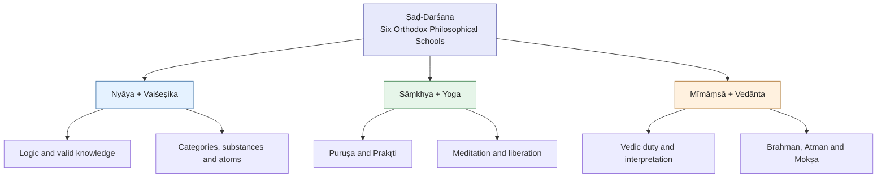

# Six Classical Orthodox Schools of Hindu Philosophy (Ṣaḍ-Darśana)

The six classical orthodox schools of Hindu philosophy are collectively known as Ṣaḍ-Darśana (षड्दर्शन), meaning six philosophical perspectives or systems.

These schools developed over many centuries, with roots in ancient Vedic thought. They differ in their explanations of reality, knowledge, consciousness, causation, liberation, and the existence of God.

Important distinction: In classical Indian philosophy, Āstika generally means accepting the authority of the Vedas. It does not necessarily mean believing in a creator God. For example, classical Sāṃkhya and early Mīmāṃsā do not require a creator God.

## 1. Historical timeline and key figures

The dates below are approximate scholarly estimates, not precise founding dates. Many schools existed as intellectual traditions before their surviving foundational texts were composed.

| School                             | Traditional founder / key figure                    | Approximate historical development                                                                         | Central focus                             |
| ---------------------------------- | --------------------------------------------------- | ---------------------------------------------------------------------------------------------------------- | ----------------------------------------- |
| Nyāya (न्याय)                      | Akṣapāda Gautama                                    | c. 2nd century BCE–2nd century CE                                                                          | Logic, reasoning, valid knowledge         |
| Vaiśeṣika (वैशेषिक)                | Kaṇāda (Ulūka)                                      | c. 2nd century BCE–2nd century CE                                                                          | Categories of reality, atomism            |
| Sāṃkhya (सांख्य)                   | Kapila; later Īśvarakṛṣṇa                           | Early roots before the Common Era; classical system by c. 4th–5th century CE                               | Consciousness and matter                  |
| Yoga (योग)                         | Patañjali                                           | c. 2nd century BCE–4th century CE                                                                          | Meditation, mental discipline, liberation |
| Pūrva Mīmāṃsā (पूर्व मीमांसा)      | Jaimini; later Śabara and Kumārila Bhaṭṭa           | c. 2nd century BCE–2nd century CE                                                                          | Dharma, Vedic ritual, interpretation      |
| Vedānta / Uttara Mīmāṃsā (वेदान्त) | Bādarāyaṇa (Vyāsa); later Śaṅkara, Rāmānuja, Madhva | Brahma Sūtra roughly c. 2nd century BCE–4th century CE; major commentarial schools from 8th century onward | Brahman, Ātman, liberation                |

These ranges refer broadly to the formation or textual codification of the schools. Their traditional founders are not always securely datable.

## 2. The six schools and their philosophical contributions

[Madhvacharya's Dvaita Vedanta (Tatvavada) and translation of Sarvamoola containing Bhagavad Gita, Upanishads, and Brahmasutra.](https://images.openai.com/static-rsc-4/I6gV2H2ykINpIuycZQTONrTKHb0yiT_9kDmDpi6a1l2eyYYwWISpsvAErIQD5H1pJSJNF9Zf3F_t6kY6efyt7p2_ZpuiUbzzhXqhLU2bGKWv570DC_fqgK9ZFdGVHZ4ZcoDVB-0V-n-pk22WesaNoFJt_qc21WbvEC8cbIEmAa0?purpose=inline)

1\. Nyāya — Logic and epistemology

Key figures: Gautama, Vātsyāyana (c. 4th–5th century CE), Udayana (c. 10th–11th century CE).

Nyāya develops methods for distinguishing valid knowledge from error. It recognizes perception, inference, comparison and reliable testimony as four pramāṇas (means of knowledge).

Key literature: Nyāya Sūtra, Nyāya Bhāṣya, Nyāyakusumāñjali.

Central question: How can we prove that what we know is true?

[Manisha Chaudhary (@ManiYogini) on X](https://images.openai.com/static-rsc-4/H3bJ-TBYI2L18k_POMQaX9TQ5TZGA-rMK1hmTXdRgMgfu2LYRhiptuUGpF14oLTf7ASod3bsV8s2Q6qlba4fELS8VlgAn_aJWrkV3gmdGqjPEQeHlg-i_0RMt6cunsJBZJYDKojK8A6Sgz5W0tiuDUy-JG6MofHjt37NrAWr5QU?purpose=inline)

2\. Vaiśeṣika — Metaphysics and atomism

Key figures: Kaṇāda, Praśastapāda (c. 5th–6th century CE).

Vaiśeṣika analyzes reality through categories such as substance, quality, motion, universality, particularity and inherence. It proposes that physical substances can be composed of indivisible atoms (paramāṇu).

Key literature: Vaiśeṣika Sūtra, Padārthadharmasaṃgraha.

Central question: What are the fundamental constituents and categories of reality?

[File:Kapila (cropped).png - Wikimedia Commons](https://images.openai.com/static-rsc-4/Aiw7vP8KR1hcYcp-qNVJBsuCabmHGOmn3FarooMYeIc8ysjtQ5c73MtnAgN0vkdkRdRh4neTFIIpYtxSCkzhu_p97I8hHs-aItT1uT3icAoABInay6B5WSYQ0pCRawVZuamimodINYFLVBF10JVAZTetm5X-FyL1w7yxlPHUceo?purpose=inline)

3\. Sāṃkhya — Consciousness and nature

Key figures: Kapila (traditional founder), Īśvarakṛṣṇa (c. 4th–5th century CE).

Sāṃkhya distinguishes Puruṣa (consciousness) from Prakṛti (primordial nature). Prakṛti evolves through three guṇas: sattva, rajas and tamas. Classical Sāṃkhya enumerates 25 tattvas and does not require a creator God.

Key literature: Sāṃkhyakārikā.

Central question: How does consciousness become entangled with material nature, and how is it liberated?

[The Origins of Yoga: A Journey Through Time](https://images.openai.com/static-rsc-4/ApgK8CSxwdB2io9LIRr0pA6sHkmeZhl9gKAZ3OaJVG9WYOTE-Rs7tFpyYymKwBBL0iCZkl1KIeacjAQCi0nwUVwH0efsL-8cOLA5_7MaPPfH_3lkuTZ5N1SEA3WkF0NIMpqth114Pzg72_n5897OCGTuzOeE2UHrD9Y9oXDyMB8?purpose=inline)

4\. Yoga — Practical discipline of consciousness

Key figures: Patañjali, Vyāsa (Yoga Bhāṣya commentator).

Closely related to Sāṃkhya, classical Yoga emphasizes control of mental fluctuations and the eight limbs of practice: yama, niyama, āsana, prāṇāyāma, pratyāhāra, dhāraṇā, dhyāna and samādhi. Unlike classical Sāṃkhya, it explicitly recognizes Īśvara as a special Puruṣa.

Key literature: Yoga Sūtra, Yoga Bhāṣya.

Central question: How can disciplined practice bring liberation from suffering?

[History of Homa Kundam in Vedic Traditions & Rituals – Mudkart](https://images.openai.com/static-rsc-4/4XJCO-baR3mfodz63Y2R-CCxHSaUPHy9UifAAdFQDP3pEEFg87L2d5RHWMu79dpPbiaQIhx1oeTyzYD9E1vrV9FeLGFyRnRR6LjpyOXS5Db4vD0FZpp9LMXWzW63t4foh8HsGywU9dVTEk-kvbLUUoyEVARH7JZpUbX4xYhvS7o?purpose=inline)

5\. Pūrva Mīmāṃsā — Dharma and scriptural interpretation

Key figures: Jaimini, Śabara (c. 5th century CE), Kumārila Bhaṭṭa and Prabhākara (c. 7th century CE).

Mīmāṃsā develops rigorous rules for interpreting Vedic injunctions and determining dharma. It examines the authority of scripture, the relationship between action and results, and how ritual actions produce consequences. Classical Mīmāṃsā does not depend on a creator God.

Key literature: Mīmāṃsā Sūtra, Śābara Bhāṣya, Ślokavārttika.

Central question: How do we determine what ought to be done?

[#opportunity #ram #sriram #ramnavami #ramnavmi #hinduism #hindu #bharat #india #blog #blogs #blogpost #blogger #bloggers #blogging #storytime #storytellers #storytelling #god #vishnu #shiva #brahma… | Akshaya R](https://images.openai.com/static-rsc-4/-28cSkx7ZRBOhth1AqPkE6M0jvhjemHqzAhsqGQSMSn3igll1F6m-i2CevJvkOLCGLYUQyFE4G6kw0K8AEbK7GjxRfp9bv17V8Xh6PQIHlM9FUJ2R2WKJyyGG-_t8-UUKKVDnyx6HeSC1PG_G2HyBLCrwq4C6b7Hp2V2Kpzz8jM?purpose=inline)

6\. Vedānta — Ultimate reality and liberation

Key figures: Bādarāyaṇa; later Śaṅkarācārya (8th century), Rāmānujācārya (11th–12th century), Madhvācārya (13th century), Vallabhācārya (15th–16th century), Caitanya Mahāprabhu (15th–16th century).

Vedānta examines the relationship between Brahman, the individual self and the universe. Its major traditions differ on whether these are ultimately identical, distinct or simultaneously one and different.

Key literature: Brahma Sūtra, principal Upaniṣads, Bhagavad Gītā and their commentaries.

Central question: What is ultimate reality, and what is the relationship between Brahman, soul and world?

## 3. How the six schools relate to one another

The six schools are traditionally grouped into three pairs because of their historical and philosophical affinities.

These pairings are useful for study, but they do not mean that each pair shares an identical philosophy.

## 4. Historical development of the major Vedānta traditions

Vedānta is one of the six orthodox schools, while Advaita, Dvaita, Viśiṣṭādvaita and the other systems are subtraditions within Vedānta, not separate members of the six darśanas.

| Period                                             | Major figure        | School              |
| -------------------------------------------------- | ------------------- | ------------------- |
| 8th century CE                                     | Śaṅkarācārya        | Advaita             |
| 11th–12th century CE                               | Rāmānujācārya       | Viśiṣṭādvaita       |
| 13th century CE                                    | Madhvācārya         | Dvaita              |
| Date disputed, often placed in the medieval period | Nimbārkācārya       | Dvaitādvaita        |
| 15th–16th century CE                               | Vallabhācārya       | Śuddhādvaita        |
| 15th–16th century CE                               | Caitanya Mahāprabhu | Achintya Bhedābheda |

## 5. Āstika versus Nāstika

As discussed in your [Wikipedia reference on Āstika and Nāstika](https://en.wikipedia.org/wiki/%C4%80stika_and_n%C4%81stika?utm_source=chatgpt.com), the classification is primarily about the acceptance of Vedic authority, rather than simply belief or disbelief in God.

| Āstika (orthodox) | Nāstika (non-orthodox in this classification) |
| ----------------- | --------------------------------------------- |
| Nyāya             | Buddhism                                      |
| Vaiśeṣika         | Jainism                                       |
| Sāṃkhya           | Cārvāka / Lokāyata                            |
| Yoga              | Other traditions rejecting Vedic authority    |
| Mīmāṃsā           |                                               |
| Vedānta           |                                               |

Nāstika does not automatically mean atheist. Jainism, for example, recognizes souls, karma and liberation while rejecting the Vedas as supreme authority.

## 6. Key takeaway

The six schools can be remembered through six fundamental questions:

| School    | Fundamental question                                      |
| --------- | --------------------------------------------------------- |
| Nyāya     | How do we know?                                           |
| Vaiśeṣika | What exists?                                              |
| Sāṃkhya   | What are consciousness and nature?                        |
| Yoga      | How do we discipline the mind and attain liberation?      |
| Mīmāṃsā   | What is dharma, and how should we act?                    |
| Vedānta   | What is ultimate reality, and how is liberation attained? |

These are useful thematic summaries, not exclusive boundaries: the schools often address many of the same questions and disagree substantially about their answers.

The important historical point is that the six darśanas did not emerge in a single sequence from one founder to the next. They developed through centuries of overlapping debates, commentary traditions and mutual criticism. The sophisticated logical debates of Śaṅkara, Rāmānuja and Madhva were possible partly because earlier traditions such as Nyāya and Mīmāṃsā had already developed extensive methods of reasoning and scriptural interpretation.
